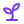

<!-- readme-standard: 2026-11-02 -->
<div align="center">



# 🎪 convention-astro — the PIR® Convention site

*The home of PIR®'s conventions, cross-linked with the WordPress hub.*

[](https://psychedelicsinrecovery.github.io/convention-astro/)
[](./LICENSE)


 **You are here:** PIR® › `convention-astro` · public · `main` is the working branch

</div>

##  TL;DR

1.  **What this is.** The site for PIR®'s conventions: the story of the Inaugural Convention (Denver, October 8-11, 2026), the gallery, and the events record.
2.  **Who it is for.** The fellowship, and anyone looking for a past or upcoming gathering.
3.  **Do this first.** [Open the site](https://psychedelicsinrecovery.github.io/convention-astro/). To work on it: `npm install`, then `npm run dev`. All the facts live in `src/data/convention.ts`.

The home of PIR®'s conventions: **https://psychedelicsinrecovery.github.io/convention-astro/**

Built from the same pattern as the [AstroLog](https://github.com/psychedelicsinrecovery/changelog-astro):
one shared arrival kit and A.L.E.X. design system loaded from the hub, a site-specific layer of
its own (`public/convention.css`), and its own navbar and footer through the kit's
`window.ARRIVAL_SITE` override. One night sky, many desks.

## What lives here

- **Overview** — the story of the Inaugural Convention (Denver, October 8-11, 2026): what happened, the four days, and cross-links to everything on the WordPress site.
- **Gallery** — the bridge to the fellowship's photos ([Pixieset album](https://pir68.pixieset.com/psychedelicsinrecoverytminauguralconventiondenver2026/) today, [our own gallery](https://github.com/psychedelicsinrecovery/gallery) as it fills).
- **Events** — past and upcoming gatherings; a record that grows as the fellowship does.

All facts live in one file — `src/data/convention.ts` — so every page tells the same story, and
the WordPress "Convention" hub page links back here.

## Develop

```sh
npm install
npm run dev     # localhost:4321/convention-astro/
npm run build
```

## Deploy

Pushes to `main` build and publish to GitHub Pages automatically (`.github/workflows/deploy.yml`).

The base path is `/convention-astro` (set in `astro.config.mjs`) because the site serves from the
hub origin as a project page. If the fellowship ever gives it a subdomain of its own, change
`base` to `"/"` and the Pages settings — everything else follows.

## The images

`public/social-card.jpg` (the og:image) and `public/gallery-preview.jpg` (the gallery cover) are
drawn by `tools/make_cards.py` (Pillow, zero other dependencies):

```sh
python3 tools/make_cards.py
```

Run it once after cloning so both images exist before the first push.

## Cross-links with WordPress

| Page | WordPress counterpart |
| ---- | --------------------- |
| Overview | psychedelicsinrecovery.org/convention-2026/ |
| Schedule | psychedelicsinrecovery.org/convention-2026-schedule/ |
| Live stream | psychedelicsinrecovery.org/convention-live-stream/ |
| Committee | service.psychedelicsinrecovery.org/convention-committee/ |

The WordPress "Convention" hub page (navbar) links back to this site.

## Trademark

Psychedelics In Recovery™ – PIR®. The marks belong to the fellowship.

---

*Tended by C.A.T.A.L.Y.S.T., PIR®'s helper fleet.*

##  Suggest a change

Noticed something? Open an [issue](https://github.com/psychedelicsinrecovery/convention-astro/issues) or a pull request against `main`; the people who tend it read them and a person with the role merges. Not on GitHub? Type `/techcom` in [PIR®'s Discord](https://discord.gg/MyprTq8w95).

<sub>The front door follows the living [README standard](https://github.com/drasticstatic/my-template/blob/main/README-STANDARD.md). Copy it, improve it.</sub>
